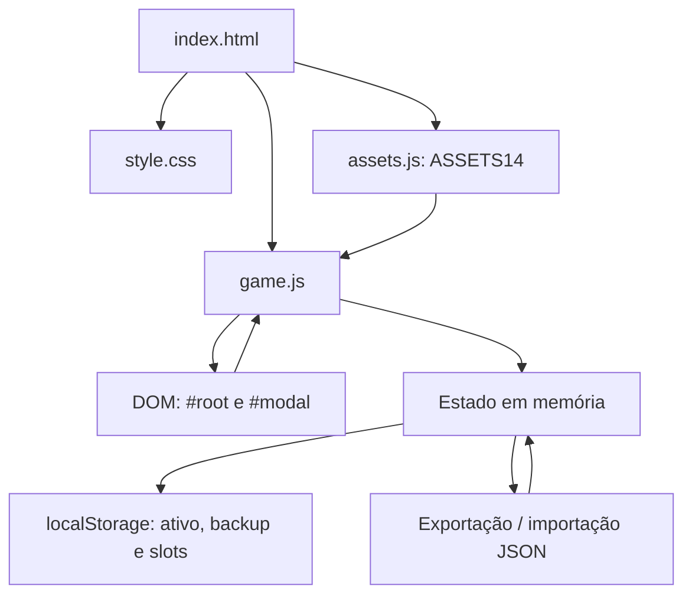

# Arquitetura técnica — Depois do Sinal v0.14

## 1. Visão geral

Aplicação web estática, em português, com HTML, CSS e JavaScript clássico. O motor opera inteiramente no navegador; não depende de backend, autenticação, banco remoto ou IA generativa em execução. O jogo pode ser distribuído como quatro arquivos ou, a partir do pacote original, como HTML independente. A versão do repositório utiliza os arquivos separados.

## 2. Arquivos e inicialização

| Arquivo | Responsabilidade |
| --- | --- |
| `index.html` | Define idioma, viewport, título e os contêineres root/modal. Carrega CSS e scripts. |
| `style.css` | Estilos base, extensões visuais por versão, responsividade e movimento reduzido. |
| `assets.js` | Mídias incorporadas; `ASSETS14` é consumido pelo motor. Não alterar índices sem revisar referências. |
| `game.js` | Dados narrativos, estado, cenas, diálogos, ações, interfaces e serviços compartilhados. |
| `LEIA-ME.txt` | Instruções originais de execução local. |

A ordem é importante: `assets.js` precede `game.js`. O motor é um script clássico e usa extensões que envolvem funções anteriores. Não trocar a ordem nem converter tudo para módulos em uma única mudança.

A inicialização usa `load()`/ `loadSave14()`, mantém `saved` e `state`, e finaliza a composição de extensões antes de chamar `render()`. O fluxo atual de interface usa HTML gerado por funções e eventos delegados por atributos `data-act`.

## 3. Subsistemas no motor atual

Os nomes abaixo correspondem ao código da v0.14, não a módulos físicos separados.

| Área | Referências do código | Responsabilidade |
| --- | --- | --- |
| Narrativa | `current()`, `choose(i)`, `episodeNames7` | Nó narrativo, texto, escolhas e cinco episódios. |
| Estado | `state`, `normalize(s)`, `persist()` | Dados da sessão, migração aditiva e persistência. |
| Personalização | extensões Ateliê v0.8.x, Signature | Roupas, aparência, catálogo e fotos. |
| BellPhone | `data90()`, `openChat90()`, extensões v0.9.x | Contatos, mensagens, notificações, temas e interações. |
| Raven | extensão v0.9.3 | Sexto interesse romântico e narrativa paralela. |
| Cidade | `cityData10()`, extensões v0.10 e v0.13 | Visitas, cenas opcionais, CGs, mapa, filtros e acesso a locais. |
| Quarto | `roomData11()` | Dia livre, diário, decoração e efeitos. |
| Mundo | `world12()`, `mem12()`, `people12` | Períodos, clima, rotina, memórias e configuração de desempenho. |
| BellFeed | `social13()`, `feedPosts13()` | Publicações, stories, respostas e deduplicação. |
| Mídia e saves | funções com sufixo `14` | Cache, validação, recuperação e exportação. |

A extensão de Raven não substitui a lista original `routes`, que contém cinco identificadores. A lista `people12` contém os seis. Evitar pressupor que ambas são equivalentes.

## 4. Persistência e compatibilidade

Chave principal: `bellmont_depois_do_sinal_v1`.

- Backup: chave principal + `:backup14`.
- Slots: chave principal + `:slot:` + índice (três slots na interface).
- O estado contém, entre outros campos, `name`, `node`, `episode`, `look`, `aff`, `trust`, `visited`, `messages`, `log`, além de objetos das extensões `raven93`, `bellphone90`, `city10`, `room11`, `world12` e `social13`.

`validSave14()` valida os campos básicos e aceita episódios 1 a 5 (ou ausência do campo para formatos antigos). `prepareSave14()` clona o JSON, valida estruturas adicionais e chama `normalize()`. `commitSave14()` aplica o estado e encerra interações transitórias.

`writeSave14()` evita gravar JSON idêntico e tenta preservar o último registro válido antes de substituí-lo. `loadSave14()` tenta o backup quando o save principal é ilegível. O backup depende da quota e disponibilidade do armazenamento. Não é garantia contra exclusão de dados pelo navegador.

**Atenção:** o limite de cinco episódios em `validSave14()` precisa ser atualizado e testado antes da inclusão do episódio 06. Não reutilizar identificadores narrativos nem alterar a chave sem migração. A validação atual não equivale a um schema formal completo.

O armazenamento é isolado por origem. O comportamento de `file://` varia entre navegadores; exportar JSON antes de mudar de URL, instalação ou navegador. Não publicar saves pessoais.

## 5. Mídia, desempenho e interface

`mediaPool14` centraliza URLs de objetos. `mediaURL14()` converte mídia base64 em Blob e reutiliza a URL no cache; `compactMedia14()` compacta referências em HTML renderizado. `withEmbedded14()` preserva mídia incorporada durante exportações que precisam ser independentes. A qualidade dos recursos originais foi mantida.

O CSS inclui layout responsivo, `prefers-reduced-motion`, `content-visibility` em partes da interface e modo de efeitos reduzidos controlado pelo mundo. O mapa é vetorial; clima e estações usam efeitos e filtros sobre cenários existentes.

Limitações atuais: `assets.js` tem cerca de 25,7 MB e é carregado na inicialização; o cache pode crescer conforme o uso. O motor ainda é monolítico, com wrappers e listeners acumulados. Não há evidência de benchmark de FPS no Firefox, testes automatizados ou CI no snapshot inicial. Qualquer ganho futuro deve ser medido com cenário, navegador e versão identificados.

## 6. Estratégia de evolução

1. Criar fixtures de save fictícias e testes de comportamento antes de refatorar.
2. Extrair serviços de mídia e persistência, com contrato estável e migrações versionadas.
3. Separar dados narrativos, lógica de domínio e componentes de interface, mantendo um ponto de entrada compatível com execução local.
4. Migrar BellPhone, cidade, quarto e mundo incrementalmente, verificando efeitos dos wrappers antigos.
5. Avaliar distribuição de mídias e build offline; não substituir arte por placeholders.
6. Medir tempo de inicialização, tamanho dos recursos, latência de interação e memória no mesmo cenário antes/depois.

Esses passos são propostas, não funcionalidades já implementadas.

## 7. Checklist de regressão

| Fluxo | Resultado esperado |
| --- | --- |
| Nova partida | Criar protagonista e iniciar episódio 01. |
| História | Percorrer os cinco episódios, testar escolhas e retornos. |
| Relações | Afinidade/confiança, Raven, memória e limites respeitados. |
| Ateliê | Trocar roupa, favoritar e exportar foto. |
| BellPhone/BellFeed | Mensagens, likes, comentários, stories e ausência de duplicação. |
| Cidade | Selecionar pinos, filtrar, visitar e concluir encontros. |
| Quarto/mundo | Diário, descanso, calendário, rotina e clima coerentes. |
| Salvamentos | Recarregar, exportar/importar JSON, testar slots e backup com perfil descartável. |
| Falhas | Importação inválida, armazenamento indisponível, ausência de erros não tratados. |
| Compatibilidade | Chromium, Firefox e viewport móvel; conferir navegação por teclado. |

Executar `node --check game.js` quando Node.js estiver disponível. Isso verifica sintaxe, não gameplay. Para testes manuais, abrir `index.html` ou servir a raiz por HTTP local. Nunca testar corrupção de save sobre o único progresso real de um jogador.

## 8. Git e publicação

Manter `main` como versão estável, `develop` como integração e branches curtas para mudanças. Revisar diffs em PRs, atualizar documentação e promover apenas após regressão. GitHub Pages pode servir a raiz de `main`; a configuração precisa ser verificada no repositório.

Esta documentação foi elaborada a partir de `index.html`, `game.js`, `style.css`, `LEIA-ME.txt` e metadados do snapshot v0.14. O arquivo de mídia não foi integralmente inspecionado. Nenhuma alteração de arquitetura executável é feita por esta documentação.
